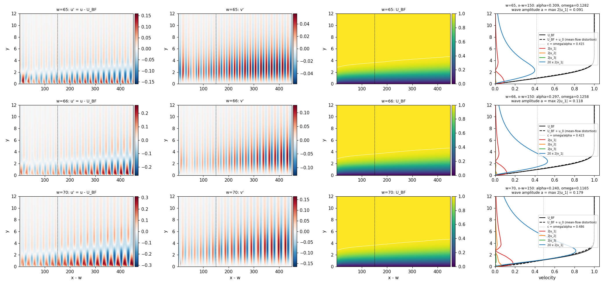
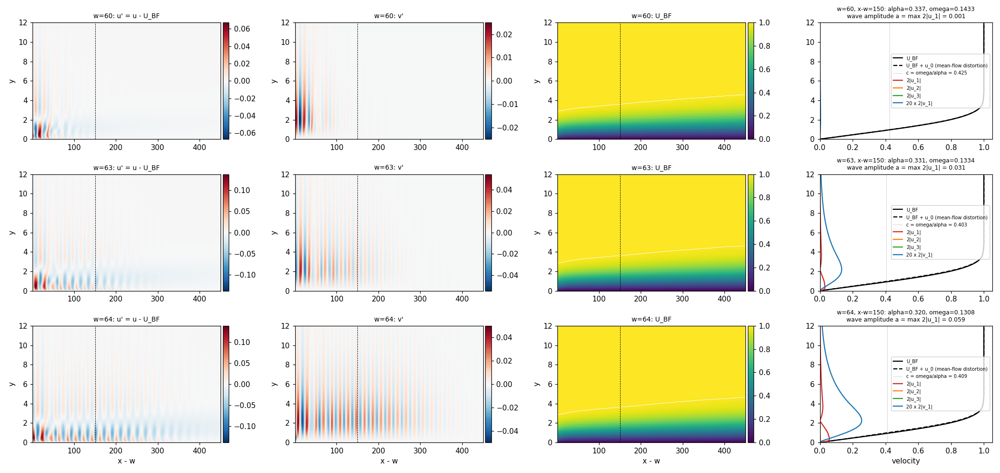
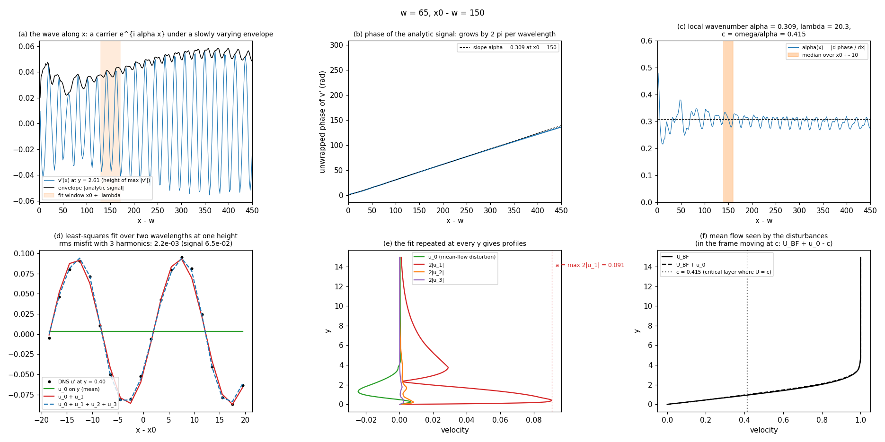
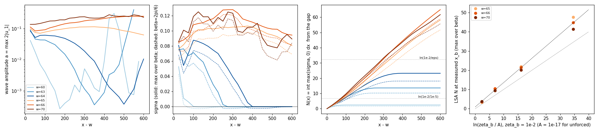
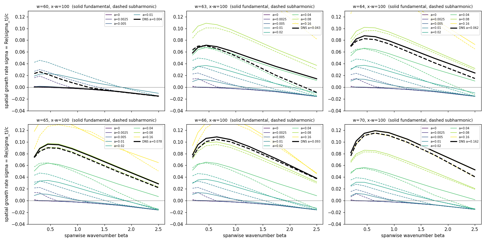
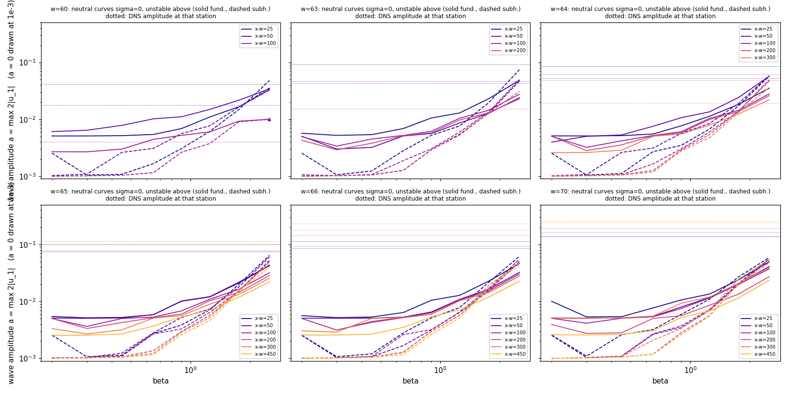
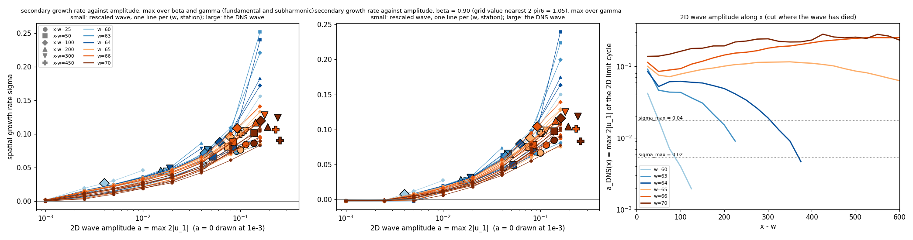
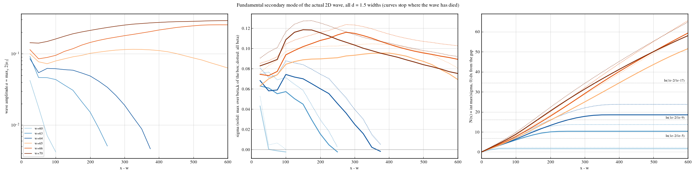
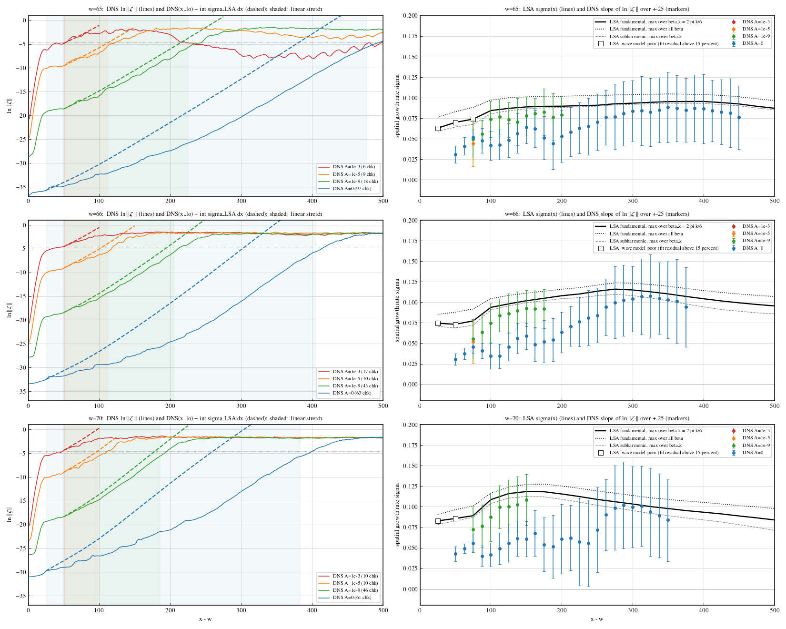

# Secondary stability of the d = 1.5 waves at Re = 1000: regions III and IV

This note collects the local secondary-stability analyses of 2026-11-04 to 11-07: what was computed, where the results are, and what they show. It covers widths w = 60, 63, 64 (region III, no breakdown) and w = 65, 66, 70 (region IV, breakdown). The region IV part is in the JFM paper (`latex/papers/jfm_incNS/main.tex`, `eq:secondaryEVP`, `fig:secStab`); the rest is not in the paper yet.

## 1. What problem is solved: temporal, converted to spatial

The analysis is **temporal**, in Herbert's (1988) Floquet formulation, and the growth rates are then **converted to spatial** ones.

- At a station x0 the 2D wave of the limit cycle is taken as locally parallel and periodic in x. In the frame moving with its phase speed c = ω/α it is steady:
  U(y, ξ) = U_BF(y) + u_0(y) − c + Σ_{n≠0} u_n(y) e^{i n α ξ}, with V likewise (n = ±1..±3).
- A 3D disturbance is sought as
  q = e^{σ_t t} e^{i β z} Σ_{m=−3..3} q_m(y) e^{i (m + γ) α ξ},
  with β real (spanwise wavenumber), γ = 0 (fundamental, K-type) or 1/2 (subharmonic, H-type), and **α real**: it is the wavenumber of the 2D wave, not an eigenvalue. The **complex temporal exponent σ_t** is the eigenvalue (dense generalised eigenproblem, 48 Chebyshev points in y ≤ 40, 7 harmonics; `src/pp/secondaryStability.py`).
- The secondary modes are phase-locked to the wave and travel with it, so a temporal growth Re(σ_t) in the wave frame is converted to a **spatial growth rate σ = Re(σ_t)/c** (the usual Gaster-type conversion used by Herbert). Every σ quoted below and plotted as "spatial growth rate" is this σ; a fully spatial analysis (complex α of the disturbance) was not done.

## 2. Inputs: what `load_wave(w)` reads (`scripts/pp/scripts/secondaryStabilityScan.py`)




Each row is one width.

- **u′ = u − U_BF and v′**: one snapshot of the 2D limit cycle (2D runs, `src/incGapRe1000/baseflow/dns/d1.5_w<w>/data/pointsPO_n600.dat`, x every 2 units, 600 points in y ≤ 150).
- **U_BF**: the steady 2D base flow on the same points (`src/quasi3DGapRe1000inc/baseflow/dns/d1.5_w<w>_Lz6.0_k32/data/bf_pointsPO_n600.dat`, interpolated on the HPC with `breakdownStudy/bfPts.job`).
- **ω** from history points (`OMEGA` in the script).
- **Right column**, at x − w = 150: `LocalWave.at(x0)` fits u′, v′ over two wavelengths to the harmonics u_0 (mean-flow distortion), u_1..u_3, v_1..v_3. α comes from the phase of v′ along x, c = ω/α, and the amplitude of the wave is **a = max_y 2|u_1|** (peak, not rms; Herbert's A = a/√2).

How α, the harmonics and a are obtained, step by step (`scripts/pp/plots/secondaryStep2.py`):



- **Since 2026-11-08 α is the value that minimises the residual of the harmonic fit of u′, v′ (y ≤ 20), searched within ±25% of the Hilbert estimate below (`LocalWave.alpha_at`, default `method="fit"`).** The Hilbert median alone was off by up to 15% for w = 70 (by 0–5% for w = 63–66), which left fit residuals of 25–40%. Results of §3–§5 (and `fig:secStab`) were computed with the Hilbert α; §8 uses the fitted α.
- (a)–(c) Hilbert estimate of α: v′(x) at the height of max |v′| is a carrier under a slowly varying envelope; the phase of its analytic signal (Hilbert transform) grows by 2π per wavelength, so α(x) = |dφ/dx|. It ripples by about ±10% (harmonics, envelope), so the median over x0 ± 10 is used. v is used rather than u because u′ has a mean part u_0 and its fundamental changes phase across the critical layer. α sets the Floquet wavenumbers (m + γ)α, c = ω/α (frame and spatial conversion) and the fit window.
- (d)–(e) harmonics: with α known, u′(x) at each y is fitted over x0 ± λ by least squares to u_0 + Σ_{n≤3} 2 Re[u_n e^{inαX}] (3 harmonics leave a misfit of 3% of the signal). This gives the base flow as a Fourier series in ξ, which is what the Floquet operator needs: base harmonic n couples disturbance harmonics m and m − n.
- a = max_y 2|u_1| is the peak amplitude of the fundamental oscillation (Herbert's rms A = a/√2). It does not enter the operator; it only labels how strong the wave is and is the quantity rescaled in the amplitude sweeps.

Region IV waves keep a ≈ 0.06–0.25 to x − w = 600. Region III waves form with similar amplitude near the gap but decay downstream: below a ≈ 0.02 at about x − w = 50, 200 and 300 for w = 60, 63 and 64. The 2D sessions and meshes for w = 63–66 differ only in W, so this is not a setup error. Why the wave changes from sustained to decaying between w = 64 and 65 is still open (ω differs by only 2%).

## 3. Region IV: growth rate and β (in the paper)

Script `scripts/pp/scripts/secondaryStabilityScan.py` → `data/stability/secondaryStability_d1.5.npz`; figure `scripts/pp/plots/secondaryStability.py` → `fig:secStab` in the paper. Stations x − w = 50..250, γ = 0 and 1/2, 19 values of β, plus a scaling sweep at x − w = 150.

- σ ≈ 0.07–0.12, most amplified β ≈ 0.5–0.7; at β_1 = 2π/6 only 5–15% lower, so Lz = 6 does not limit the growth much.
- σ lies about 15% above the measured slopes of ‖ζ‖ in the 3D DNS (parallel-flow approximation).

## 4. Integrated amplification N(x) across III / IV

Script `scripts/pp/scripts/secondaryStabilityNfactor.py` → `data/stability/secondaryStabilityNfactor_d1.5.npz` (6 widths, x − w = 25..600 every 25, 6 values of β, γ = 0). Figure `scripts/pp/plots/secondaryNfactor.py`:



N(x) = ∫ max(σ, 0) dx from the gap is the amplification available to a 3D disturbance seeded there; breakdown needs A e^N ≈ ζ_b = 10⁻².

- **Calibration** on the 12 measured breakdown positions of region IV (w = 65, 66, 70 × A = 10⁻³, 10⁻⁵, 10⁻⁹, unforced ≈ 10⁻¹⁷): N_LSA(x_b) = 1.26 ln(10⁻²/A) + 0.93 (the analysis overestimates N by about 26%, consistent with §3).
- **Results**:

| w | 60 | 63 | 64 | 65 | 66 | 70 |
|---|---|---|---|---|---|---|
| N_max (x − w ≤ 600) | 2.4 | 13.6 | 23.2 | ≥ 58 | ≥ 65 | ≥ 62 |
| 3D seed A needed to break down | ~3×10⁻³ | ~4×10⁻⁷ | ~2×10⁻¹⁰ | any | any | any |

For w ≥ 65, N is still growing at x − w = 600 (lower bounds). The unforced runs have A ≈ 10⁻¹⁷, between the w = 64 and w = 65 thresholds, which is why the III/IV line falls between 64 and 65. With disturbances of 10⁻⁵–10⁻³ the line would move to w ≈ 60–63. The thresholds are extrapolated from the region IV calibration: order of magnitude only.

## 5. Herbert-style amplitude sweep

Script `scripts/pp/scripts/secondaryStabilityAmplitude.py` → `data/stability/secondaryStabilityAmplitude_d1.5.npz` (~70 min on the laptop). At stations x − w = 25, 50, 100, 200, 300, 450 the wave keeps its DNS shape and is rescaled to a = 0, 0.0025, …, 0.16 with the weakly nonlinear scaling (`LocalWave.operator(..., power=True)`: harmonic n × s^|n|, u_0 × s², s = a/a_DNS), and σ(β) is computed for γ = 0 and 1/2 and 8 values of β. Figures `scripts/pp/plots/secondaryAmplitude.py`:





- **No real amplitude threshold.** The fundamental starts growing at a ≈ 0.003–0.005, the subharmonic below 0.0025 (and at small β it is weakly unstable already at a = 0: oblique primary modes of U_BF). Same for all widths and stations. The minimum is at the smallest β computed (0.2–0.3).
- **σ depends on a only.** σ_max ≈ 0.02 at a ≈ 0.005, 0.04 at a ≈ 0.018, 0.09 at a ≈ 0.1, for all six widths to within 10–20%. The curves separate only for a ≳ 0.1, where the region III waves are scaled up the most.
- **So the III/IV difference is entirely in the 2D wave amplitude a(x)** (third panel): region IV keeps σ ≈ 0.07–0.12 along the whole domain; in region III the wave is as unstable near the gap but decays, and the growth fades out with it, which is why N saturates at 2.4 / 13.6 / 23.2.
- The varied amplitude is a diagnostic: for each w the limit cycle and a(x) are fixed. It separates the effect of the amplitude from that of the wave shape, α and c, which the N-factor alone cannot do.

## 6. Status of the 3D runs related to this

- Region III 3D runs have **not** had a continuous seed: w = 60, 63 only initial noise (decayed back to 2D); w = 64 a temporary A = 10⁻⁵ kick (broke down while forced, returned to 2D after). Continuous-seed test of §4/§8 submitted 2026-11-08: `d1.5_w{63,64}_Lz6.0_k32_seed{1e-5,1e-9}` (w63 from chk 39, w64 from chk 59; PBS 4580730–37, two chained 24 h jobs each). Predicted: w64 breaks down at 10⁻⁵, marginal at 10⁻⁹; w63 breaks down at 10⁻⁵, not at 10⁻⁹.
- w = 65 at Lz = 12, 64 modes, seed 10⁻⁹ (typhoon, `src/quasi3DGapRe1000inc/baseflow/dns/d1.5_w65_Lz12.0_k64_seed1e-9`): tests whether the wider box (β_max ≈ 0.5–0.7 fits) moves x_b − w from 168 to the predicted ~153. Results expected around 10–11 Nov.

## 7. Caveats

- Local, parallel-flow analysis; temporal rates converted with c (§1).
- The rescaled waves of §5 are not Navier–Stokes solutions (Herbert's shape assumption).
- Fits where the DNS wave has died are noise and are discarded (w = 60 from x − w = 200, w = 63 from 300, w = 64 from 450; `amp > 0.5` in the N-factor).
- ζ_b = 10⁻² and the linear calibration of §4 are assumptions carried over from region IV.

## 8. Clean analysis at the actual amplitude, all widths, against the 3D DNS (fitted α)

Script `scripts/pp/scripts/secondaryStabilityAll.py` → `data/stability/secondaryStabilityAll_d1.5.npz` (6 widths, x − w = 25..600 every 25, 19 β, γ = 0 and 1/2, ~1 h; stations downstream of the first one with a < 3×10⁻³ skipped). Figures `scripts/pp/plots/secondaryVsDNS.py`. No amplitude rescaling: each wave as it is in the limit cycle.



| w | 60 | 63 | 64 | 65 | 66 | 70 |
|---|---|---|---|---|---|---|
| N(600), β_k of the Lz = 6 box | 1.6 | 10.3 | 18.5 | 51.5 | 59.3 | 58.0 |
| N(600), all β | 2.3 | 13.7 | 23.7 | 58.1 | 65.5 | 64.8 |
| wave dies (a < 3×10⁻³) at x − w | 125 | 275 | 400 | – | – | – |

- The fundamental eigenvalue is real (|Im λ|/Re λ < 10⁻⁹): phase-locked to the wave, as stated in the paper.
- Most amplified β ≈ 0.5 near the gap, 0.67 downstream for w = 66, 70; 0.3–0.5 in region III.
- c = 0.40–0.42 (w = 65), 0.41–0.43 (66), 0.44–0.47 (70); the old Hilbert value c ≈ 0.49 for w = 70 at x − w = 150 is now 0.454.
- w = 60: fit residual 20–60% at every station where the wave lives, so its numbers are only indicative.
- The N values in §4 barely change (2.4/13.6/23.2 → 2.3/13.7/23.7 with all β).



Comparison with the slopes of ln‖ζ‖ in the 3D DNS (region IV only; region III has no continuous-seed runs):

| run | stretch x − w | σ_DNS / σ_LSA (whole stretch) | same, x − w ≥ 100 | same, x − w ≥ 250 |
|---|---|---|---|---|
| w65 A=1e-9 | 50–226 | 0.84 | 0.87 | |
| w66 A=1e-9 | 50–206 | 0.85 | 0.88 | |
| w70 A=1e-9 | 50–186 | 0.85 | 0.87 | |
| w65 A=0 | 25–478 | 0.75 | 0.77 | 0.88 |
| w66 A=0 | 25–406 | 0.69 | 0.72 | 0.89 |
| w70 A=0 | 25–384 | 0.63 | 0.65 | 0.89 |
| A=1e-5 (all w) | 50–~110 | 0.6–0.7 | | |
| A=1e-3 | none: already at ‖ζ‖ ≈ 10⁻² by x − w = 50 | | | |

- Where the disturbance has settled on the secondary mode, the DNS grows at **0.87–0.89 of the LSA rate for every width and every seed**. The LSA is 12–15% too high: the parallel-flow approximation, as before.
- Closer to the seed the DNS grows more slowly: 50–70 units after the forcing for A = 10⁻⁹ and 10⁻⁵ (the seed projecting onto the mode), and up to x − w ≈ 250 for A = 0, where ‖ζ‖ ≈ 10⁻¹⁶–10⁻¹⁴ is round-off noise and not a single mode.
- Integrated: Δln‖ζ‖ DNS against ∫σ_LSA is 12.7–12.9 against 14.6–14.9 for A = 10⁻⁹, but 24–30 against 38–40 for A = 0, because of the slow upstream stretch.

## Reproduce

From `scripts/pp`:

```bash
OMP_NUM_THREADS=1 .venv/bin/python scripts/secondaryStabilityNfactor.py      # ~15 min, adds missing widths
OMP_NUM_THREADS=1 .venv/bin/python scripts/secondaryStabilityAmplitude.py    # ~70 min
OMP_NUM_THREADS=1 .venv/bin/python scripts/secondaryStabilityAll.py          # ~1 h, §8
.venv/bin/python plots/secondaryVsDNS.py
.venv/bin/python plots/secondaryWaveInputs.py
.venv/bin/python plots/secondaryNfactor.py
.venv/bin/python plots/secondaryAmplitude.py
```
